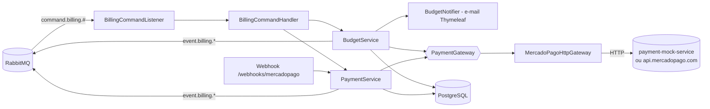

# Billing Service — Orçamento e Pagamento (Mercado Pago)

Microsserviço responsável por **gerar e enviar orçamentos**, registrar a **aprovação/recusa do cliente** e
**registrar/verificar pagamentos** via **Mercado Pago (Checkout Pro)**, informando o OS Service por eventos.

| Item | Valor |
|---|---|
| Porta | `8082` |
| Banco | **PostgreSQL** (`billing_db`) — dados financeiros exigem transações ACID e integridade referencial |
| Mensageria | consome `command.billing.#` (fila `billing-service.commands` + DLQ) e publica `event.billing.*` |
| Integração | API do Mercado Pago (preferências, consulta, estorno, webhook) — por padrão o **simulador `payment-mock-service`** |
| Swagger | `http://localhost:8082/swagger-ui.html` |

## Responsabilidades
- `command.billing.budget.create` → cria o orçamento (itens + total), **envia e-mail** com links de aprovar/recusar
  (token aleatório) e publica `event.billing.budget.created`.
- Cliente aprova → cria a **preferência no Mercado Pago** e publica `event.billing.budget.approved` com o link de pagamento.
- Cliente recusa → `event.billing.budget.rejected` (o orquestrador compensa).
- **Webhook** `/webhooks/mercadopago` → consulta o pagamento na API (não confia no corpo da notificação) e publica
  `event.billing.payment.confirmed` ou `event.billing.payment.failed`. Notificações duplicadas são ignoradas.
- **Compensações**: `command.billing.budget.cancel` (cancela orçamento e cobrança pendente) e
  `command.billing.payment.refund` (estorno no Mercado Pago → `event.billing.payment.refunded`).

## Arquitetura interna



## Provedor de pagamento (Mercado Pago)
Documentação oficial: <https://www.mercadopago.com.br/developers/pt/docs/checkout-pro>

| Operação | Endpoint usado |
|---|---|
| Criar link de pagamento | `POST /checkout/preferences` (`external_reference` = id do orçamento, `notification_url` = webhook) |
| Verificar pagamento | `GET /v1/payments/{id}` |
| Estorno (compensação) | `POST /v1/payments/{id}/refunds` |

Conforme orientação do professor, o pagamento usa um **serviço separado que imita o Mercado Pago**: o repositório
**`payment-mock-service`**. O Billing não sabe se está falando com o simulador ou com o provedor real. A escolha é só configuração:

| Variável (`.env`) | Simulador (padrão) | Mercado Pago real |
|---|---|---|
| `MP_API_BASE_URL` | `http://payment-mock-service:8084` | `https://api.mercadopago.com` |
| `MP_ACCESS_TOKEN` | igual a `MOCK_ACCESS_TOKEN` | Access Token de teste do painel |
| `MP_WEBHOOK_SECRET` | igual a `MOCK_WEBHOOK_SECRET` | assinatura secreta do webhook |
| `MP_NOTIFICATION_URL` | `http://billing-service:8082/webhooks/mercadopago` | URL pública (ex.: ngrok) |

O webhook valida o header `x-signature` (HMAC-SHA256) e, em seguida, consulta o pagamento na API, sem confiar no corpo da notificação.

## Endpoints
| Método | Rota | Auth |
|---|---|---|
| GET | `/api/budgets`, `/api/budgets/service-order/{osId}` | JWT |
| GET | `/api/payments/service-order/{osId}` | JWT |
| GET | `/api/public/budgets/{token}` / `approve` / `reject` / `payment-return` | link do e-mail |
| POST | `/webhooks/mercadopago` | assinatura `x-signature` |

## Executar, testar e entregar
```bash
cp .env.example .env
./mvnw verify          # testes + JaCoCo (gate 80%)
./mvnw spring-boot:run
```
**Evidência de cobertura (JaCoCo):** 32 testes, **98,3% de linhas**, 83,1% de branches. Inclui teste de contrato da API do
Mercado Pago com `MockRestServiceServer` e validação HMAC do webhook. Relatório em `target/site/jacoco/index.html`
(artefato `jacoco-report` no CI). SonarCloud com Quality Gate no pipeline.

CI/CD em `.github/workflows/ci-cd.yml` e manifestos em `k8s/`, com o mesmo padrão do OS Service.
